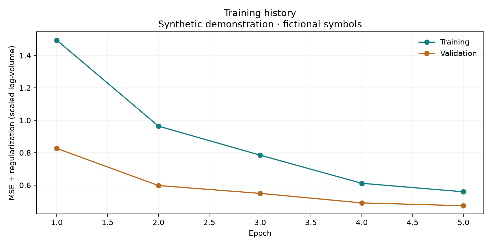
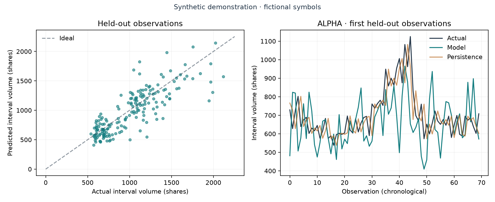

# Intraday Volume Lab

### Python research portfolio by Bikash Kushwaha

A reproducible exploration of intraday volume forecasting with a convolutional neural network, aggregate context features, and instrument embeddings. This maintained edition emphasizes correct volume arithmetic, causal data preparation, chronological evaluation, and readable research reporting.

**The included example is synthetic.** ALPHA and BETA are fictional instruments. The project demonstrates a verified Python workflow and does not claim real-market forecasting performance or live trading capability.

## Project overview and architecture

The target is **next-minute interval volume in shares**, predicted from the previous 15 complete minute bars. The notebook explains each stage; the shared Python module keeps numerical logic testable and avoids duplicate training code.

```text
JSON-lines tick files
    → schema, timestamp, and quote validation
    → session-aware counter increments and minute bars
    → contiguous historical windows and context features
    → shared train / validation / test date boundaries
    → scalers and instrument vocabulary fitted on training only
    → CNN + context encoder + instrument embedding
    → evaluation against persistence, saved model, and static report
```

| Component | Responsibility |
| --- | --- |
| [Intraday_Volume_Lab.ipynb](Intraday_Volume_Lab.ipynb) | One documented, executable experiment |
| [volume_lab.py](volume_lab.py) | Validation, volume conversion, features, splitting, training, metrics, and CLI |
| [tests](tests/test_volume_lab.py) | Numerical regression checks and a real TensorFlow save/reload check |
| [data/sample](data/sample) | Reproducible fictional tick records across eight short sessions |
| [tools/export_report.py](tools/export_report.py) | Export the executed notebook for static review/hosting |
| [site/index.html](site/index.html) | Pre-generated static research report |
| [docs/DATA.md](docs/DATA.md) | Schema, counter assumptions, target, and evaluation policy |

The architecture retains the supplied notebook's two Conv1D layers (64/32 filters), 32-unit context branch, 8-dimensional instrument embedding, and 128/64-unit regression layers. Training uses Adam, dropout, layer normalization, L2 regularization, early stopping, and checkpointing. **CMEM residual estimation is not implemented**; scientific context and source contributions are documented in [Source acknowledgement](SOURCE_ACKNOWLEDGEMENTS.md).

## Core features

- Multiple files per instrument are combined; exact duplicate records are removed.
- Timestamp units and the exchange timezone are explicit.
- Daily cumulative counters become interval volume, with partial initial observations and counter resets handled explicitly.
- Feature windows never cross a session boundary or a missing minute.
- All instruments share whole-date evaluation boundaries; scalers fit training data only.
- Results distinguish log-volume metrics from errors in original share units.
- A persistence baseline makes the neural model's results interpretable.
- Runs save model/preprocessing artifacts, input hashes, configuration, library versions, predictions, and labeled figures.
- A synthetic dataset supports a complete local demonstration without accounts, API keys, or private Drive access.

## Technology stack

**Python 3.12 · TensorFlow/Keras · NumPy · pandas · scikit-learn · Matplotlib · Jupyter · pytest · Ruff**

Direct dependencies are pinned in [requirements.txt](requirements.txt), notebook/testing tools in [requirements-dev.txt](requirements-dev.txt), and the complete validated environment snapshot in [requirements-lock.txt](requirements-lock.txt). The full suite passed locally on Windows CPU and in Ubuntu GitHub Actions with Python 3.12. The recorded five-epoch notebook experiment ran on Windows CPU.

## Setup and installation

Install 64-bit Python 3.12 and Git. From this project's root folder in PowerShell:

```powershell
python -m venv .venv
.\.venv\Scripts\python.exe -m pip install -r requirements-lock.txt
.\.venv\Scripts\python.exe -m pytest
.\.venv\Scripts\python.exe -m ruff check .
```

Using an existing `uv` installation instead:

```powershell
uv venv --python 3.12
uv pip install -r requirements-lock.txt
.\.venv\Scripts\python.exe -m pytest
```

For a lighter numerical environment, install only NumPy, pandas, scikit-learn, and pytest using their pinned versions, then run `python -m pytest -m "not integration"`. The full suite includes a short real TensorFlow training run.

TensorFlow's official [installation guide](https://www.tensorflow.org/install/pip) covers supported runtimes and Windows system requirements. A GPU is unnecessary for this small example.

### Run the experiment

The sample inputs are already included. Train directly from the command line:

```powershell
.\.venv\Scripts\python.exe volume_lab.py train --data data/sample --output artifacts/demo --epochs 5 --data-label "Synthetic demonstration - fictional symbols"
```

Alternatively, open the notebook in an editor with Jupyter support and select the `.venv` interpreter. Start it from the project root and run all cells in order. There is one training operation.

To execute it from PowerShell:

```powershell
.\.venv\Scripts\python.exe -m ipykernel install --user --name intraday-volume-lab --display-name "Python 3 (Intraday Volume Lab)"
.\.venv\Scripts\python.exe -m nbconvert --to notebook --execute --inplace --ExecutePreprocessor.kernel_name=intraday-volume-lab --ExecutePreprocessor.timeout=240 Intraday_Volume_Lab.ipynb
.\.venv\Scripts\python.exe tools/export_report.py
```

The export script requires all notebook cells to have executed successfully. It refreshes the static report, documented figures, and result snapshot from that run. Regenerating the notebook with `tools/build_notebook.py` resets its saved outputs, so execute it again before export.

### Inspect the static report

The exported report is already included and needs no Python training to view:

```powershell
python -m http.server 8000 --bind 127.0.0.1 --directory site
```

Open `http://127.0.0.1:8000`. Stop the server with Ctrl+C. See [publication instructions](docs/PUBLISHING.md) for GitHub and Vercel.

### Generate a fresh synthetic dataset

The generator refuses to overwrite an existing dataset. Use an empty directory:

```powershell
.\.venv\Scripts\python.exe volume_lab.py sample --output data/sample-new --seed 42
```

For your own JSON-lines inputs, follow [the data contract](docs/DATA.md). Store private datasets in the ignored `data/private/` directory. Set `--timestamp-unit ms` when your timestamps use milliseconds; units are not guessed.

## Results and reproducibility

The checked synthetic run is recorded in [the result snapshot](docs/results/synthetic-demo.json) and the executed notebook. It includes library versions, seed, input hashes, date ranges, sample counts, and metrics for both the CNN and persistence baseline.

With the default sample and lookback, the experiment has 720 windows: 450 training, 90 validation, and 180 test samples. Performance is reported in share units and log-volume units separately. Compare the neural model with persistence before drawing conclusions; the short demonstration is not tuned to beat that baseline.

In the recorded five-epoch run, test MAE is **165.19 shares for the CNN** and **94.79 shares for persistence**. Persistence performs better on this synthetic example. The report preserves that comparison rather than presenting an unsupported improvement claim.





The original archive's charts and scores have not been reused as current results. Real-data reproduction requires an authorized dataset that was not included in the supplied materials.

### Generated artifacts

```text
artifacts/demo/                 # ignored local outputs
  best.keras
  model.keras
  preprocessing.pkl
  results.json
  test-predictions.csv
  figures/
docs/results/synthetic-demo.json
docs/figures/
site/index.html
site/results.json
```

Preprocessing uses Python pickle for local model/scaler persistence. Load only artifacts from a trusted run. The public result snapshots use JSON.

## Presentation and project report

| Document | Contents |
| --- | --- |
| [Editable PowerPoint](docs/presentation/Intraday_Volume_Lab.pptx) | Eight slides covering the objective, architecture, dataset, model, results, testing, and live report. Diagrams, tables, and the comparison chart remain editable. |
| [Presentation PDF](docs/presentation/Intraday_Volume_Lab_Slides.pdf) | A matching slide view for quick reading and sharing. |
| [Technical project report](docs/reports/Intraday_Volume_Lab_Report.pdf) | A six-page explanation of data preparation, model design, evaluation, recorded results, setup, reproducibility, and limitations. |

All three documents describe the included synthetic demonstration and retain the recorded persistence comparison.

## Screenshots and demo links

Documentation screenshots belong in `docs/screenshots/`; exported charts belong in `docs/figures/`. Capture the final report overview, data-validation table, held-out metrics, and a narrow viewport. The [publication guide](docs/PUBLISHING.md) includes naming and capture instructions.

The included screenshots were captured from the verified live report at 1440 × 1000 and 390 × 844. See the [verification record](docs/VERIFICATION.md) for checks, environment details, and remaining limits.


Other views: [data validation](docs/screenshots/02-data-and-boundaries.png), [held-out evaluation](docs/screenshots/03-evaluation.png), and [mobile report](docs/screenshots/04-report-mobile.png).

| Link | Status |
| --- | --- |
| GitHub repository | [BikashCoder31/intraday-volume-lab](https://github.com/BikashCoder31/intraday-volume-lab) |
| Vercel live report | [intraday-volume-lab.vercel.app](https://intraday-volume-lab.vercel.app) |
| Local report | `http://127.0.0.1:8000` while the local server is running |

## Limitations and next work

This is a bounded, memory-resident research example. It assumes local calendar-date sessions and monotonic cumulative counters between feed resets. An overnight market, incomplete feed, or different schema needs a revised session/input policy. The included 60-minute synthetic sessions are shorter than a normal trading day.

There is no live market connection, serving API, order execution, or CMEM estimator. Before reporting real-market performance, use verified real data, appropriate baselines, longer held-out histories, and documented experiments. Full details are in [the data contract](docs/DATA.md).

## Maintainer and source

**Bikash Kushwaha** maintains this portfolio edition and its cleanup, verification, documentation, and synthetic demonstration. The supplied research source and technical references remain acknowledged in [SOURCE_ACKNOWLEDGEMENTS.md](SOURCE_ACKNOWLEDGEMENTS.md). Original academic submission documents are outside this edition.
