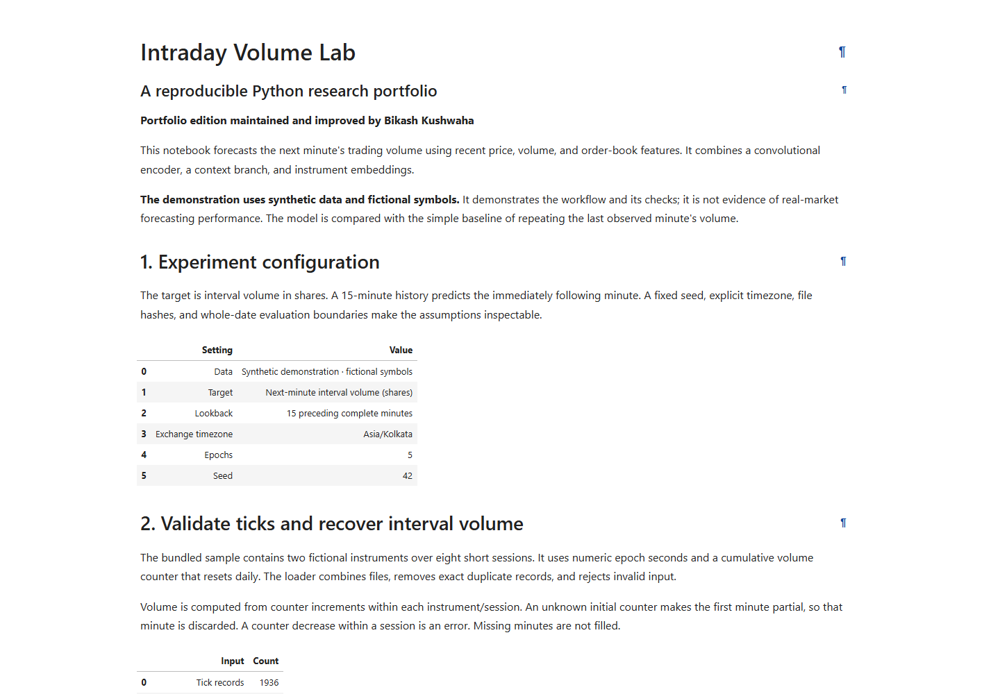
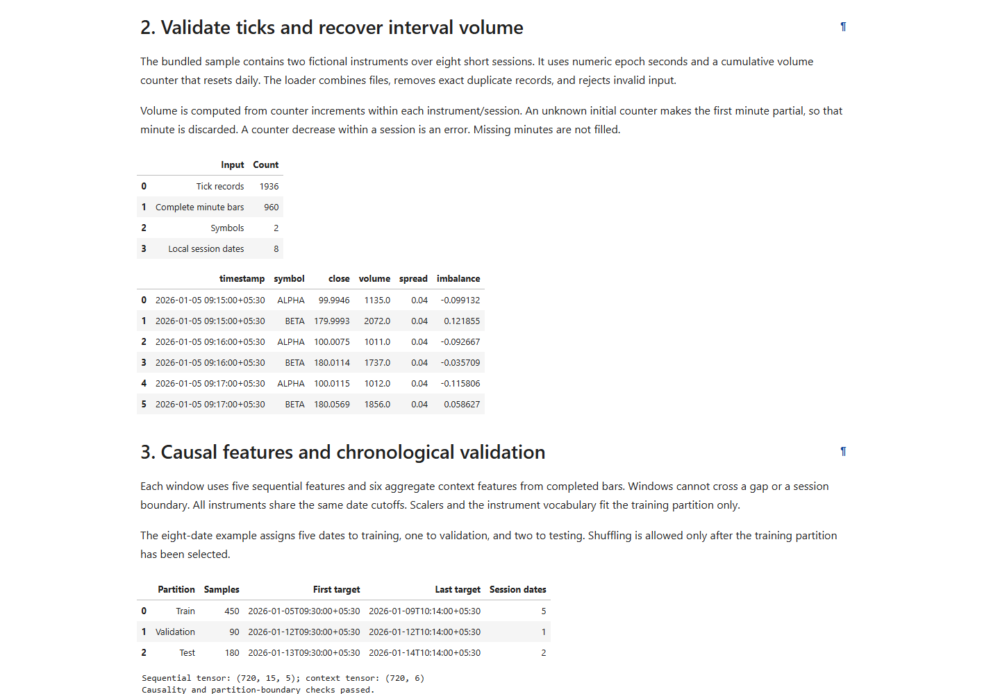
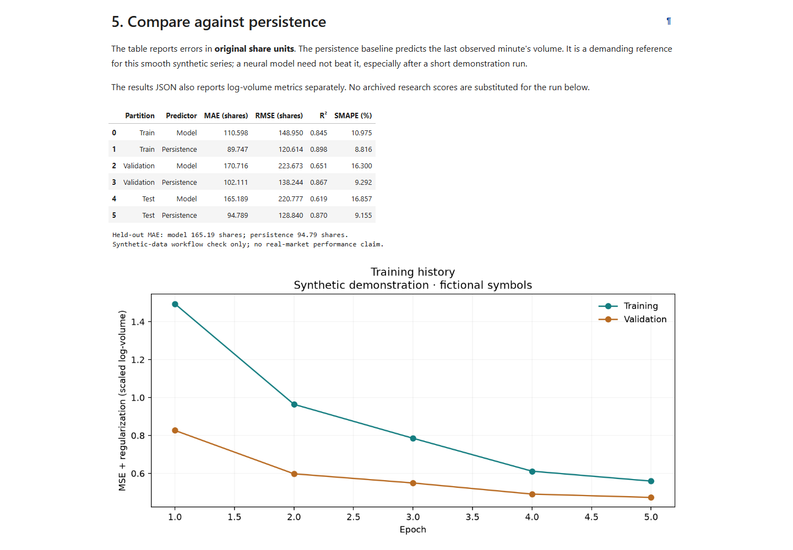
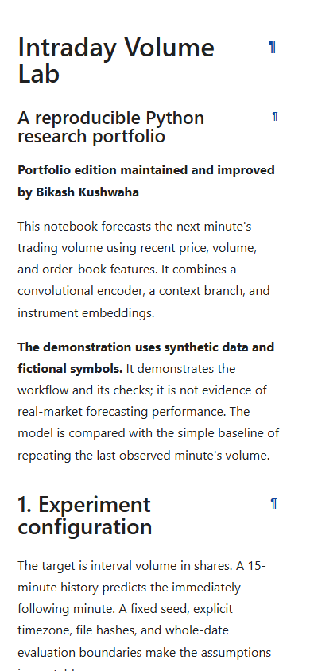

# Verification record

Checked on 20 October 2026. This record covers the maintained portfolio edition, its synthetic experiment, its passing Ubuntu GitHub Actions workflow, and its verified public Vercel report.

- [Public GitHub repository](https://github.com/BikashCoder31/intraday-volume-lab)
- [Production report](https://intraday-volume-lab.vercel.app)
- [Automated check history](https://github.com/BikashCoder31/intraday-volume-lab/actions)

## Python and experiment checks

| Check | Result |
| --- | --- |
| Full pytest suite | 30 passed, including real TensorFlow training and model save/reload |
| Ruff lint | Passed |
| Ruff format check | Passed |
| Notebook | All code cells executed successfully in order; five training epochs completed |
| Report consistency | Notebook run ID, saved results, and implementation hash agree |
| Synthetic sample | 1,936 ticks, 960 minute bars, 720 forecasting windows |
| Whole-date split | 450 training / 90 validation / 180 test windows |
| Historical source preservation | All 53 extracted files still match the supplied ZIP byte for byte |

The environment was Windows CPU, Python 3.12.14, TensorFlow 2.20.0, Keras 3.15.1, NumPy 2.3.5, pandas 3.0.1, scikit-learn 1.9.1, and Matplotlib 3.11.2. `requirements-lock.txt` records the complete installed snapshot.

The full suite reported 43 upstream Keras/NumPy `__array__` deprecation warnings. They were not suppressed; the numerical assertions and artifact reload check passed.

The experiment run ID is `e6d8efd4da9249249b41685cc62209ed`. [The result snapshot](results/synthetic-demo.json) includes the seed, library versions, input hashes, date boundaries, training history, and both predictors' metrics.

| Held-out predictor | MAE in shares | RMSE in shares |
| --- | ---: | ---: |
| CNN | 165.19 | 220.78 |
| Persistence | 94.79 | 128.84 |

Persistence performs better in this short synthetic demonstration. No archived scores or real-market performance claims have been substituted.

Additional regression checks cover volume allocation after raw feed gaps, ingestion configuration in result provenance, mixed notebook/artifact exports, and invalid timezone error handling.

## Static report QA

The flow under test was: open the local report → inspect the overview and data section → follow the evaluation heading link → verify its URL fragment and rendered results → inspect a narrow viewport.

Environment: [the public report](https://intraday-volume-lab.vercel.app), Microsoft Edge automated with Playwright, desktop 1440 × 1000 and mobile-sized 390 × 844. The same flow was checked on the local report before publication.

| Required check | Result and evidence |
| --- | --- |
| Page identity | HTTP 200; title is Intraday Volume Lab; Bikash Kushwaha and synthetic-data labels are visible |
| Meaningful first screen | Overview, purpose, maintainer, and experiment configuration render |
| Error overlays | No framework overlay or notebook traceback observed |
| Console health | No browser warnings, console errors, or uncaught page errors |
| Figures | Every report image loads with nonzero dimensions; exported charts visually inspected |
| Interaction | Clicking the evaluation heading link updates the URL fragment and reaches its section |
| Result consistency | The visible report run ID matches `site/results.json` |
| Responsive layout | Neither viewport has horizontal page overflow; wide tables can scroll inside their output area |
| Screenshots | Overview, data section, evaluation, and mobile captures included below |

The browser check initially exposed nbconvert's hidden anchor links and inconsistent output alignment. `site/report.css` makes the links visible, aligns narrative and tables, limits line length, provides keyboard focus outlines, and keeps tables within the viewport. The same interaction and screenshot checks passed after these changes.

Key verification commands, from the project root using the virtual environment:

```powershell
python -m pytest
python -m ruff check .
python -m ruff format --check .
python -m nbconvert --to notebook --execute --inplace --ExecutePreprocessor.kernel_name=intraday-volume-lab --ExecutePreprocessor.timeout=240 Intraday_Volume_Lab.ipynb
python tools/export_report.py
python -m http.server 8787 --bind 127.0.0.1 --directory site
```

The Playwright check used `chromium.launch({channel: 'msedge', headless: true})`, `page.goto`, visible-heading locators, an anchor click with a URL assertion, console listeners, image/overflow checks, and screenshots.

## Remaining scope

The full suite passed on Windows CPU and Ubuntu GitHub Actions. Actual mobile hardware, macOS, Firefox, and Safari have not been verified. No real-market data, overnight-session policy, live API, trading execution, or CMEM estimator is included. Synthetic results verify this workflow and do not establish investment performance.

## Screenshots





